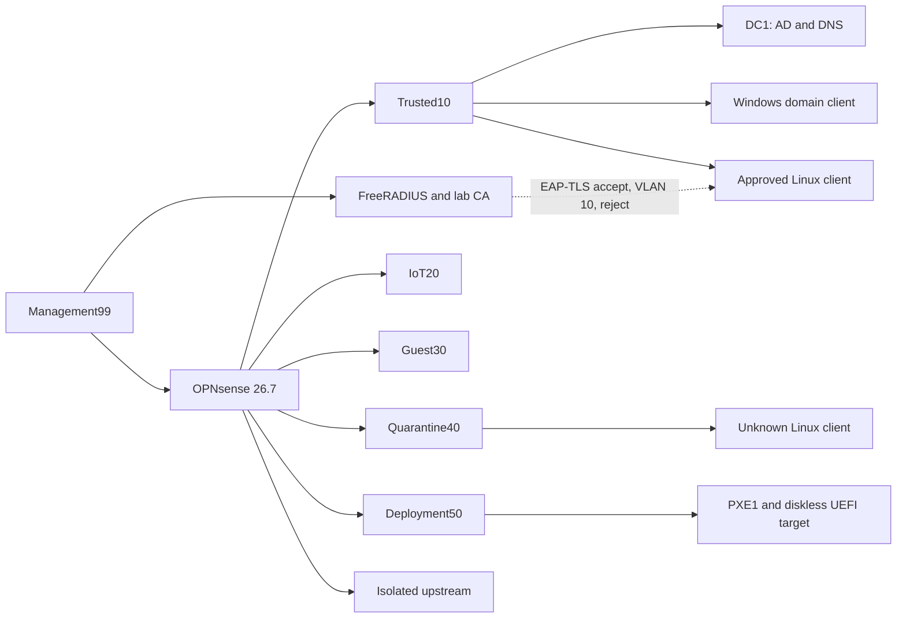

# Enterprise Home Network Virtual Lab

Current result: isolated virtual lab validated with sanitized public evidence

## Why I started this project

I built this isolated Hyper-V lab as a working virtual version of the network I plan to implement in my home. It gives me a practical way to learn how identity, DNS, routing, segmentation, certificate-based access decisions, and deployment services work together while I continue acquiring the physical hardware.

I based the design on my three-computer home environment and the network roles I want to add around it. I defined the architecture, device roles, learning goals, isolation rules, evidence requirements, and stopping conditions. I reviewed the resulting configurations, failures, corrections, screenshots, hashes, and validation records before accepting each stage.

I use AI to speed up research, documentation, testing, and project work while keeping validation and final decisions in my hands.

The lab gives me hands-on practice with the same planning, configuration, troubleshooting, validation, and recovery work I will need when I translate the design to physical equipment.

## What I built

The lab is an isolated enterprise-style network built on Hyper-V. It covers Windows Server identity and DNS, Group Policy, Windows LAPS, OPNsense routing and segmentation, FreeRADIUS EAP-TLS decisions, persistent approved and quarantined clients, and a diskless PXE service-response test.

Every lab switch uses Hyper-V Private networking. The environment does not connect to or replace the household router, DHCP, DNS, firewall, Wi-Fi, or physical network.

## How the lab connects to my planned home network

The virtual environment models the main roles I want in the physical build: Trusted, IoT, Guest, Quarantine, Deployment, and Management networks. I use the lab to understand how the services and devices should work together before I purchase, install, and test the remaining hardware in my home.

### Planned physical hardware and what each part will do

Exact new product models have not been selected yet. The current plan is organized by the role each device must fill:

- **Router or firewall appliance:** provides the Internet edge, routes traffic between approved networks, applies firewall policy, and records the traffic needed for troubleshooting.
- **Managed Ethernet switch:** carries the wired network, separates ports and VLANs, connects the three computers and infrastructure devices, and may enforce RADIUS-based access decisions if the selected model supports it.
- **VLAN-aware wireless access point:** maps wireless devices and SSIDs to the correct network, keeps guest and IoT traffic separated, and may take part in certificate-based access control if the selected model supports it.
- **Server or virtualization host:** runs the selected identity, DNS, policy, RADIUS, PXE, and management services in a form that can be backed up and recovered.
- **Backup storage:** protects configuration exports, deployment files, project evidence, and the data needed to restore the environment after a failure.
- **UPS coverage:** keeps the network and server devices stable during short power interruptions and gives them time to shut down safely during a longer outage.
- **Direct wired Ethernet paths:** provide the reliable links needed for the server, switch, management work, and the first PXE deployment tests.

The virtual lab is the current working environment. Purchasing and installing the physical equipment is the next phase after the products, budget, placement, recovery path, and compatibility requirements are reviewed.

## Lab-validated architecture

## Verified results

| Area | Result |
|---|---|
| Recovery | Hash-verified local backup and sample restore preserved |
| Hyper-V isolation | Seven Private lab switches, no physical binding, host adapter, or lab NAT |
| Active Directory | Private AD domain, DNS, domain client, OU/user/group/GPO/LAPS workflow tested |
| OPNsense | Six segment gateways plus isolated upstream installed and running |
| Segmentation | Trusted allow; IoT, Guest, and Quarantine denies; narrow Deployment DNS path |
| FreeRADIUS | Local accept/reject, EAP-TLS accept, VLAN 10 response, and untrusted-certificate reject |
| Test clients | Persistent approved and unknown Alpine clients installed and validated |
| PXE | DHCP lease and WDS service response to a diskless UEFI target |

## What the current result supports

The current evidence supports the virtual architecture, guided implementation, troubleshooting, and validation work described above. Physical 802.1X, MAB, dynamic VLAN enforcement, household-network deployment, and Windows image deployment remain part of the later hardware phase and will need their own tests.

## How I worked through it

1. Verify backup and recovery.
2. Inventory the host and record risks.
3. Build private virtual switches.
4. Build AD, DNS, client identity, and policy.
5. Install OPNsense and apply default-deny segmentation.
6. Install FreeRADIUS and the lab certificate authority.
7. Prove EAP-TLS accept and reject results.
8. Install approved and unknown endpoints and test the allow or block paths.
9. Preserve the safe diskless PXE service-response boundary.
10. Record which results are complete in the virtual lab and which still require the physical equipment.

## What failed and what I learned

The project kept failed results instead of writing around them:

- A correct Deployment rule still failed until the return route and DNS-specific endpoint firewall coverage were reviewed together. This reinforced that routing must work in both directions.
- The first diskless PXE attempt received no lease because DHCP authorization was incomplete. The service path passed only after that dependency was corrected and the original test was repeated.
- The approved and unknown Linux clients booted from their installed disks, but their live-session network settings had not carried into the installed systems. Post-install validation caught the difference before the result was accepted.
- FreeRADIUS could return an accept, reject, and network-role response, but a physical switch or access point would still need to enforce that decision. A policy decision is not the same as physical network access control.

These failures are part of the project because they show how I review a result, narrow the cause, apply one correction, and repeat the original test.

## How I review the evidence

I keep each claim tied to a positive test, a denied or negative test when appropriate, and an explicit limit:

- Isolation checks cover private-switch type, physical binding, host access, and NAT exposure.
- Segmentation checks cover an approved path and denied IoT, Guest, and Quarantine paths.
- EAP-TLS checks cover an approved certificate, returned network role, and untrusted-certificate rejection.
- Persistent-client checks cover the installed system after reboot, not only the temporary live environment.
- PXE checks cover the DHCP and WDS service response while preserving the boundary that no operating system was deployed.

## Public evidence limits

This public README was derived from a 25-file, hash-verified local package. The full package remains private because it contains detailed lab addressing, host and domain identifiers, build procedures, and screenshots that are useful for local evidence but unnecessary for understanding the public project.

Credentials, private keys, shared secrets, household addresses, recovery data, raw logs, private configuration exports, full machine inventories, and unrelated personal information are not published.

## Where to start

1. Review the architecture to understand how the seven private Hyper-V networks fit together.
2. Read the verified results to see what passed.
3. Read the failed results to see what changed and why.
4. Review the planned hardware section to see how the virtual design will translate to the physical home network.

