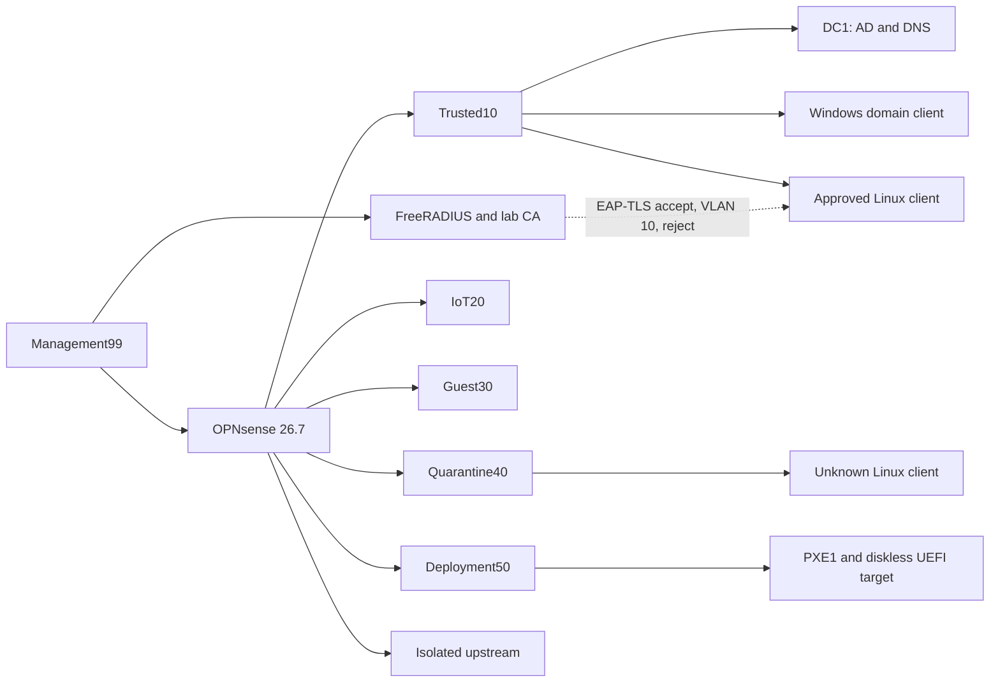

# AI-Assisted Enterprise Home Network Virtual Lab

Status: Lab-validated virtual mirror with sanitized public evidence

## Why I started this project

I wanted a safe way to learn how identity, DNS, routing, segmentation, certificate-based access decisions, and deployment services fit together instead of treating each topic as a separate tutorial.

I defined the architecture, device roles, learning goals, isolation rules, evidence requirements, and stopping conditions. I then directed an AI-assisted implementation and reviewed the resulting configurations, failures, corrections, screenshots, hashes, and validation records before accepting each stage.

I use AI to speed up research, documentation, testing, and project work while keeping validation and final decisions in my hands.

This is not a claim that I configured every component from memory. It is a documented learning environment that shows how I define requirements, control risk, review evidence, troubleshoot failures, and separate a lab result from a production claim.

## What the lab demonstrates

The lab is an isolated enterprise-style network built on Hyper-V. It covers Windows Server identity and DNS, Group Policy, Windows LAPS, OPNsense routing and segmentation, FreeRADIUS EAP-TLS decisions, persistent approved and quarantined clients, and a diskless PXE service-response test.

Every lab switch uses Hyper-V Private networking. The environment does not connect to or replace the household router, DHCP, DNS, firewall, Wi-Fi, or physical network.

## Lab-validated architecture

## Verified results

| Area | Result |
|---|---|
| Recovery | Hash-verified local backup and sample restore preserved |
| Hyper-V isolation | Seven Private lab switches, no physical binding, host adapter, or lab NAT |
| Active Directory | `ad.hanzlab.test`, DNS, domain client, OU/user/group/GPO/LAPS workflow tested |
| OPNsense | Six segment gateways plus isolated upstream installed and running |
| Segmentation | Trusted allow; IoT, Guest, and Quarantine denies; narrow Deployment DNS path |
| FreeRADIUS | Local accept/reject, EAP-TLS accept, VLAN 10 response, and untrusted-certificate reject |
| Test clients | Persistent approved and unknown Alpine clients installed and validated |
| PXE | DHCP lease and WDS service response to a diskless UEFI target |

## Important claim boundary

This project supports claims about requirements definition, directed AI-assisted implementation, evidence review, troubleshooting, and validation of a virtual network design. It does not prove independent production administration, physical 802.1X, MAB, dynamic VLAN enforcement, household-network deployment, or Windows image deployment.

## Workflow

1. Verify backup and recovery.
2. Inventory the host and record risks.
3. Build private virtual switches.
4. Build AD, DNS, client identity, and policy.
5. Install OPNsense and apply default-deny segmentation.
6. Install FreeRADIUS and the lab certificate authority.
7. Prove EAP-TLS accept and reject results.
8. Install approved and unknown endpoints and test the allow or block paths.
9. Preserve the safe diskless PXE service-response boundary.
10. Separate private evidence from public claims and document what remains physical work.

## Repository map

- `docs/01-workflow-and-learning-goals.md`
- `docs/02-architecture.md`
- `docs/03-build-journal.md`
- `docs/04-validation-and-recovery.md`
- `docs/05-security-and-privacy.md`
- `docs/06-full-build-reference.md`
- `docs/07-network-topology-drafts.md`
- `docs/08-enterprise-home-network-virtual-mirror.md`
- `docs/09-validation-results.md`
- `docs/10-what-i-learned.md`
- `evidence/accepted-checkpoints.md`
- `evidence/images/README.md`

## Where to start

1. Read [Workflow and Learning Goals](docs/01-workflow-and-learning-goals.md) for the learning plan and AI-assisted implementation boundary.
2. Read [Architecture](docs/02-architecture.md) and [Enterprise Home Network Virtual Mirror](docs/08-enterprise-home-network-virtual-mirror.md) for the accepted virtual design.
3. Read [Validation Results](docs/09-validation-results.md) for the pass results and explicit non-claims.
4. Review [Accepted Checkpoints](evidence/accepted-checkpoints.md) and the sanitized screenshots.

## Public evidence boundary

The public files were selected from a hash-verified return package and reviewed for credentials, private keys, shared secrets, household addresses, recovery data, and unrelated personal information. Raw logs, private configuration exports, full machine inventories, and private implementation evidence remain outside this repository.

